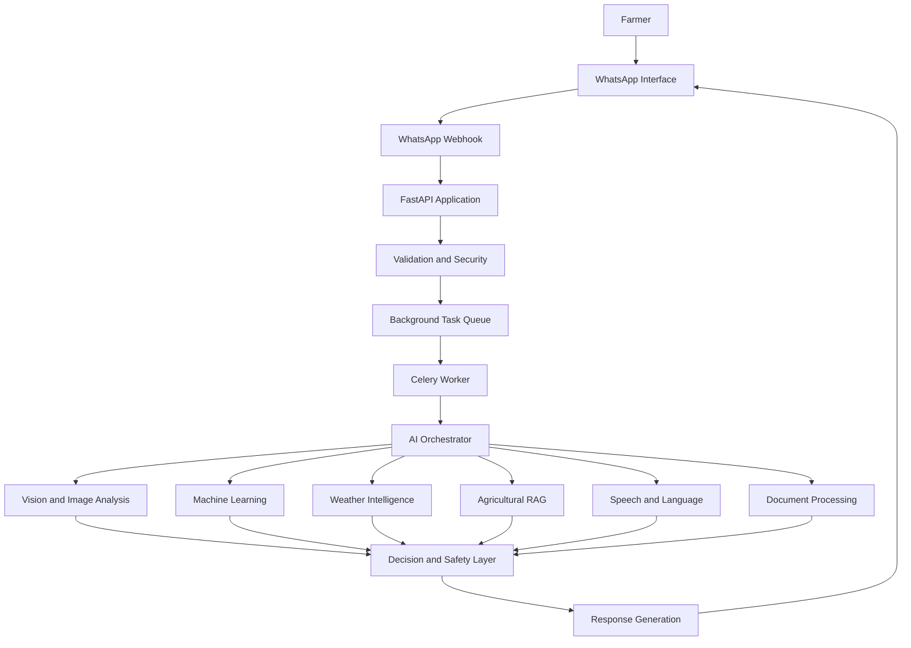
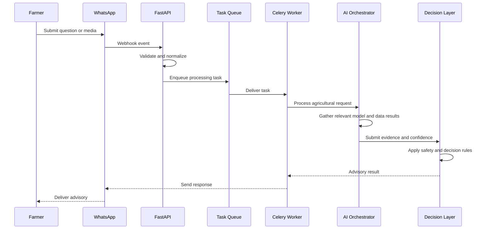
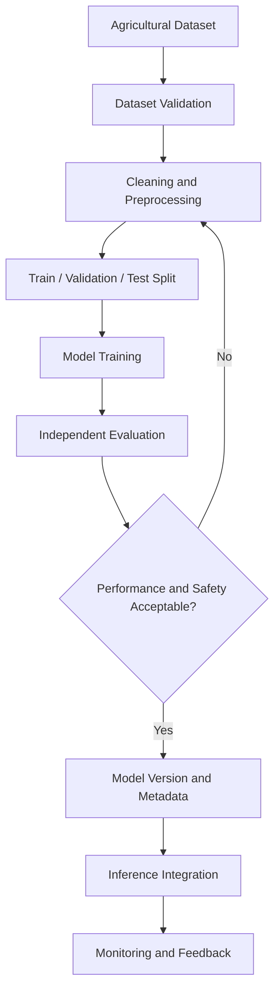
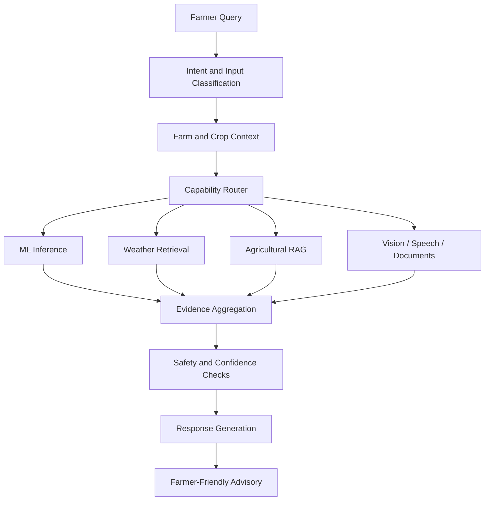

# KrishiMitra-AI
### Intelligent Agriculture. Accessible to Every Farmer.

<p align="center">
  <strong>A WhatsApp-first, multilingual AI-powered agricultural advisory platform.</strong>
  <br />
  Helping farmers understand crop health, weather conditions, pest risks, irrigation needs, and agricultural decisions through accessible AI technology.
</p>

<p align="center">
  <a href="https://github.com/Abir-Ghosh-sudo/KrishiMitra-AI">
    
  </a>
  
  
  
  
</p>

<p align="center">
  <a href="#overview">Overview</a> •
  <a href="#the-problem">Problem</a> •
  <a href="#solution">Solution</a> •
  <a href="#architecture">Architecture</a> •
  <a href="#machine-learning">Machine Learning</a> •
  <a href="#installation">Installation</a> •
  <a href="#roadmap">Roadmap</a>
</p>

---

## Overview

Agriculture depends on timely information. A farmer may need to identify a crop disease, understand changing weather conditions, assess pest risks, decide when to irrigate, or choose an appropriate crop for a particular field.

However, useful agricultural information is often fragmented across different applications, websites, experts, and services. Access can be difficult when farmers face language barriers, limited connectivity, or a lack of technical knowledge.

**KrishiMitra-AI** is designed to bring these capabilities together through a conversational agricultural advisory system.

Instead of requiring farmers to learn a separate application, the platform follows a WhatsApp-first approach. Farmers can interact through familiar messaging workflows and, as the platform evolves, provide text, voice messages, crop photographs, location information, and agricultural documents.

The backend is designed as a modular AI system that can coordinate machine learning models, weather information, agricultural knowledge retrieval, and safety-aware recommendations.

### Project vision

> Make intelligent agricultural assistance accessible, understandable, and actionable for farmers—regardless of their technical background or preferred language.

## The Problem

Farmers regularly encounter decisions that require timely and context-specific information.

| Challenge | Why it matters |
|---|---|
| Crop disease identification | Incorrect identification can lead to unnecessary treatment or crop loss. |
| Pest management | Pest risks can change with weather, crop stage, and local conditions. |
| Weather uncertainty | Rainfall, temperature, humidity, and extreme weather affect farming decisions. |
| Irrigation planning | Poor irrigation decisions can waste water and affect crop health. |
| Soil and crop selection | Crop suitability depends on soil, climate, water, and local conditions. |
| Language barriers | Agricultural information is not always available in a farmer's preferred language. |
| Fragmented information | Farmers may need to consult several different sources to make one decision. |

KrishiMitra-AI aims to connect these information sources through one consistent advisory workflow.

## The Solution

KrishiMitra-AI is designed around five principles:

1. **Accessibility:** WhatsApp-first interaction instead of requiring a dedicated farmer-facing application.
2. **Multimodal interaction:** Support for text, images, voice, location, and documents as the platform develops.
3. **Context awareness:** Consider crop, farm, soil, weather, location, and previous interactions when relevant.
4. **Evidence-oriented recommendations:** Combine model predictions with retrieved agricultural knowledge and external data.
5. **Responsible AI:** Communicate uncertainty, confidence, limitations, and when human expert review is necessary.

## Product Experience

The following diagrams are conceptual UI and interaction designs. They illustrate the intended farmer experience, not screenshots of a completed production application.

### 1. WhatsApp-first farmer experience

```text
┌───────────────────────────────────────┐
│              KRISHIMITRA              │
│          Agricultural Assistant       │
├───────────────────────────────────────┤
│                                       │
│  Farmer                               │
│  My tomato leaves have brown spots.   │
│  What should I do?                    │
│                                       │
│  Farmer                               │
│  [Crop photograph attached]           │
│                                       │
│  KrishiMitra                          │
│  I will assess the image and consider │
│  the crop information and conditions. │
│                                       │
│  ┌─────────────────────────────────┐  │
│  │ Crop health assessment          │  │
│  │                                 │  │
│  │ Possible issue: Under review    │  │
│  │ Confidence: To be evaluated     │  │
│  │                                 │  │
│  │ Next step: Check the affected   │  │
│  │ leaves and provide more context│  │
│  └─────────────────────────────────┘  │
│                                       │
│  Ask a follow-up question...          │
└───────────────────────────────────────┘
```

### 2. Agricultural intelligence dashboard concept

```text
┌─────────────────────────────────────────────────────────────┐
│ KRISHIMITRA                                      FARM OVERVIEW│
├───────────────────┬─────────────────────────────────────────┤
│                   │                                         │
│ Overview          │  FARM INTELLIGENCE                      │
│ Crop Health       │                                         │
│ Weather           │  ┌──────────────┐ ┌───────────────────┐  │
│ Pest Risk         │  │ Weather      │ │ Crop Health       │  │
│ Irrigation        │  │ Conditions   │ │ Assessment        │  │
│ Soil Analysis     │  │ Temperature  │ │ Model evaluation  │  │
│ Recommendations   │  │ Humidity     │ │ and confidence    │  │
│                   │  └──────────────┘ └───────────────────┘  │
│                   │                                         │
│                   │  ┌──────────────┐ ┌───────────────────┐  │
│                   │  │ Pest Risk    │ │ Irrigation        │  │
│                   │  │ Assessment   │ │ Recommendation    │  │
│                   │  │ Risk factors │ │ Water planning    │  │
│                   │  └──────────────┘ └───────────────────┘  │
│                   │                                         │
│                   │  FARM ACTIVITY                          │
│                   │  Recent advisory and feedback history   │
│                   │                                         │
└───────────────────┴─────────────────────────────────────────┘
```

This dashboard is a product-design concept. The primary farmer interaction remains WhatsApp-first.

---

## Core Capabilities

The repository is organized into dedicated application and domain packages. The capabilities below describe the system's intended scope; a package or route existing in the repository does not automatically mean that the corresponding feature is fully implemented, trained, or production-ready.

### 1. Crop Disease Intelligence

Designed to support crop disease assessment from submitted photographs and relevant crop context.

Potential workflow:

- Receive a crop or leaf image.
- Validate and preprocess the image.
- Run the configured inference model.
- Evaluate prediction confidence.
- Return an understandable assessment.
- Escalate uncertain cases for expert review.

### 2. Pest Intelligence

Designed to distinguish between visual pest identification and environmental pest-risk prediction.

The system can use relevant context such as:

- Crop type and crop stage.
- Temperature and humidity.
- Weather conditions.
- Location and seasonal context.
- Historical observations, where available.

Image-based pest detection and tabular pest-risk prediction are separate ML tasks and should be evaluated separately.

### 3. Weather Intelligence

Weather information is an important input to agricultural decisions.

The weather domain is organized around capabilities such as:

- Weather data retrieval.
- Location-aware forecasts.
- Historical weather information.
- Weather caching.
- Agricultural risk calculations.

Potential applications include rainfall awareness, heat-risk assessment, humidity-related disease conditions, and irrigation planning.

### 4. Irrigation Intelligence

Designed to support water-management decisions using relevant agricultural and environmental information.

Possible inputs:

- Crop type.
- Crop stage.
- Soil characteristics.
- Temperature.
- Humidity.
- Rainfall.
- Weather forecasts.
- Available irrigation information.

The objective is to support informed water management rather than provide unsupported fixed irrigation schedules.

### 5. Crop Recommendation

Designed to evaluate crop suitability using structured agricultural information.

Potential inputs include:

- Soil properties.
- pH and nutrient information.
- Climate conditions.
- Rainfall.
- Temperature.
- Water availability.
- Geographic context.

Recommendations should include their assumptions and limitations.

### 6. Soil Intelligence

The soil domain can support structured soil information, analysis, and downstream recommendation workflows.

Potential inputs include soil pH, nitrogen, phosphorus, potassium, moisture, and other available measurements.

### 7. Agricultural RAG

Retrieval-Augmented Generation is intended to connect conversational AI with relevant agricultural knowledge.

A typical workflow:

1. Understand the farmer's question.
2. Identify relevant agricultural context.
3. Retrieve useful knowledge sources.
4. Rank and filter retrieved evidence.
5. Generate a grounded response.
6. Communicate uncertainty when evidence is insufficient.

RAG is intended to complement ML predictions, not replace model validation or expert judgment.

### 8. Voice and Multilingual Interaction

The platform is designed to support farmers who prefer regional languages and voice-based communication.

The planned workflow includes speech input, language identification, transcription, agricultural reasoning, and a response in the appropriate language.

Actual language and speech capabilities depend on the configured providers and deployed models.

### 9. Agricultural Documents

The document domain is intended to support agricultural reports and other relevant documents.

Potential processing stages include file validation, text extraction, information retrieval, and contextual use in advisory workflows.

### 10. Feedback and Continuous Improvement

Feedback is important for improving advisory quality.

The platform architecture includes dedicated feedback and event-related domains so that future evaluation workflows can consider user feedback, model performance, and system behaviour.

---

## System Architecture

KrishiMitra-AI follows a modular monorepo architecture.

The main architectural separation is:

- `apps/` contains application entry points and orchestration.
- `packages/` contains reusable domain capabilities.
- `db/` contains database-related resources.
- `models/` and `data/` organize model and dataset resources.
- `docs/` contains project documentation.
- `infrastructure/` contains deployment-related resources.
- `tests/` contains testing resources.

### High-level architecture



*Conceptual target architecture. Not every integration or processing stage is claimed to be operational.*

### Request lifecycle



### Design principles

- Keep business logic outside transport-specific API routes.
- Separate synchronous request handling from long-running processing.
- Use shared contracts between application and domain packages.
- Keep model inference separate from model training.
- Treat external services as replaceable integrations.
- Validate inputs before processing.
- Track failures and important processing events.
- Make uncertain predictions visible rather than presenting them as facts.

---

## Repository Structure

The following is a simplified overview of the repository's organization.

```text
KrishiMitra-AI/
│
├── apps/
│   ├── api/                  # FastAPI application
│   ├── worker/               # Background processing
│   └── scheduler/            # Scheduled jobs
│
├── packages/
│   ├── ai/                   # AI orchestration
│   ├── alerts/               # Alert capabilities
│   ├── cache/                # Caching abstractions
│   ├── contracts/            # Shared contracts
│   ├── core/                 # Shared core utilities
│   ├── database/             # Database access
│   ├── decision_engine/      # Decision logic
│   ├── documents/            # Document processing
│   ├── events/               # Event handling
│   ├── expert/               # Expert review workflows
│   ├── farm/                 # Farm context
│   ├── feedback/             # Feedback handling
│   ├── geospatial/           # Geographic capabilities
│   ├── language/             # Language processing
│   ├── market/               # Market-related capabilities
│   ├── ml/                   # ML training and inference
│   ├── observability/        # Monitoring and logging
│   ├── optimization/         # Optimization
│   ├── privacy/              # Privacy controls
│   ├── rag/                  # Retrieval-Augmented Generation
│   ├── recommendation/       # Recommendation logic
│   ├── safety/               # Safety and validation
│   ├── security/             # Security utilities
│   ├── simulation/           # Simulation capabilities
│   ├── soil/                 # Soil intelligence
│   ├── speech/               # Speech processing
│   ├── storage/              # Storage abstractions
│   ├── sustainability/       # Sustainability logic
│   ├── vision/               # Image and visual processing
│   ├── weather/              # Weather intelligence
│   └── whatsapp/             # WhatsApp integration
│
├── data/                     # Dataset resources
├── db/                       # Database and migration resources
├── docs/                     # Documentation and ADRs
├── infrastructure/           # Infrastructure configuration
├── models/                   # Model artifacts and metadata
├── scripts/                  # Development and utility scripts
├── tests/                    # Automated tests
│
├── .github/
│   └── workflows/            # GitHub automation
│
├── alembic.ini
├── apps-tree.txt
├── packages-tree.txt
├── docker-compose.yml
├── docker-compose.prod.yml
├── pyproject.toml
├── uv.lock
├── Makefile
├── CONTRIBUTING.md
├── SECURITY.md
├── CHANGELOG.md
└── README.md
```

This tree describes the repository's modular organization, not a guarantee that every package contains a complete implementation.

---

## Technology Stack

The project uses a Python-first architecture with a modular application and package layout.

| Layer | Technology / component | Purpose |
|---|---|---|
| Main language | Python 3.13 | Application and ML development |
| Dependency management | UV | Workspace and dependency management |
| API | FastAPI | HTTP API and webhook handling |
| Background processing | Celery | Asynchronous workloads |
| Database | PostgreSQL | Persistent structured data |
| Geospatial data | PostGIS | Geographic queries and spatial context |
| Cache and broker | Redis | Caching and task infrastructure |
| ML framework | PyTorch and compatible estimators | Model development and inference |
| Computer vision | Vision package | Image-processing workflows |
| Weather | Weather package | Forecast and historical weather workflows |
| AI knowledge | RAG package | Evidence retrieval |
| Messaging | WhatsApp package | Farmer communication |
| Migrations | Alembic | Database schema evolution |
| Containers | Docker Compose configuration | Local and deployment infrastructure |

Exact versions and optional integrations should be taken from `pyproject.toml`, `uv.lock`, and the relevant package configuration.

---

## Machine Learning Architecture

Machine learning is one of the most important parts of KrishiMitra-AI.

However, agricultural intelligence is not one single prediction problem. Disease classification, pest detection, irrigation prediction, crop recommendation, and yield estimation require different datasets, architectures, and evaluation methods.

### Current ML implementation status

The repository contains a reusable ML architecture with model-injection patterns.

The existing generic training infrastructure accepts an estimator and delegates fitting and prediction to it. Disease inference and pest-risk inference similarly work with injected model objects.

**This means the generic infrastructure does not, by itself, establish which concrete algorithm is configured, whether a model has been trained, or whether production model weights exist.**

Do not interpret the algorithms in the next table as already trained or deployed models.

### Recommended model strategy

| Agricultural task | Recommended starting point | Task type |
|---|---|---|
| Crop disease classification | EfficientNet-B0 | Image classification |
| Crop stage classification | EfficientNet-B0 | Image classification |
| Pest image detection | YOLO11n | Object detection |
| Pest risk prediction | CatBoost / XGBoost | Classification or regression |
| Crop recommendation | CatBoost | Classification |
| Irrigation prediction | XGBoost / CatBoost | Classification or regression |
| Yield prediction | CatBoost Regressor | Regression |
| Soil-based prediction | CatBoost / Random Forest | Classification or regression |

These are proposed candidates. Final selection should be based on dataset quality, validation performance, inference requirements, and deployment constraints.

### Proposed training pipeline



### Dataset preparation

Every model needs a dataset that matches its exact task.

**Image classification datasets**

- Correct crop and disease labels.
- Consistent image formats.
- Appropriate train, validation, and test splits.
- Class imbalance analysis.
- Image augmentation where appropriate.
- Careful handling of duplicate images.

**Object detection datasets**

- Bounding-box annotations.
- Consistent class IDs.
- Annotation quality checks.
- Independent evaluation data.
- Detection metrics such as mAP.

**Tabular agricultural datasets**

- Correct units and measurement ranges.
- Missing-value handling.
- Categorical feature encoding.
- Leakage prevention.
- Location-aware and time-aware validation.

### Evaluation standards

| Task | Useful metrics |
|---|---|
| Classification | Precision, recall, F1-score, confusion matrix |
| Imbalanced classification | Macro F1, per-class recall, PR-AUC |
| Object detection | mAP50, mAP50-95 |
| Regression | MAE, RMSE, R² |
| Probability quality | Calibration and reliability analysis |

For agricultural deployment, a high overall accuracy is not sufficient. A model should also be evaluated on difficult examples, unseen farms or locations, and classes where false negatives can cause significant harm.

### Model reliability

The system should consider:

- Confidence thresholds.
- Out-of-distribution inputs.
- Model versioning.
- Dataset provenance.
- Reproducible training.
- Expert escalation for uncertain cases.
- Monitoring after deployment.

A model prediction is an estimate, not a guaranteed diagnosis.

---

## AI Orchestration and RAG

KrishiMitra-AI is designed to combine different forms of agricultural intelligence instead of relying on one general-purpose language model.

### Proposed orchestration flow



### Why RAG?

Agricultural advice can depend on local conditions, crop varieties, disease characteristics, and regional practices.

RAG can help retrieve relevant information before a response is generated.

A reliable implementation should preserve source information, avoid unsupported claims, and distinguish retrieved evidence from model-generated interpretation.

---

## WhatsApp-First Workflow

The WhatsApp integration is designed to act as the farmer-facing communication layer.

### Supported input directions

| Input | Intended processing |
|---|---|
| Text message | Intent detection and agricultural reasoning |
| Crop photograph | Image validation and visual inference |
| Voice message | Speech processing and language handling |
| Location | Geographic and weather context |
| Document | Document extraction and knowledge retrieval |

### Message processing considerations

- Webhook validation.
- Duplicate event handling.
- Input validation.
- Media download and storage controls.
- Asynchronous processing for long-running tasks.
- Retry and failure handling.
- Response delivery tracking.
- Privacy-aware logging.

The actual availability of each input type depends on the configured WhatsApp integration and deployed processing services.

---

## Data and Model Management

A reliable agricultural AI system needs more than model code.

It needs reproducible datasets, clear model metadata, controlled artifacts, and evaluation records.

The repository separates `data/` and `models/` so that these resources can be managed independently from application code.

### Recommended data organization

```text
data/
├── raw/
├── interim/
├── processed/
├── external/
└── metadata/
```

This is a recommended organization for datasets; use the existing repository layout where it differs.

### Recommended model artifact organization

```text
models/
├── disease/
├── pest/
├── crop_stage/
├── irrigation/
├── recommendation/
└── metadata/
```

Model artifacts should be versioned and accompanied by:

- Model architecture and version.
- Training dataset reference.
- Feature definitions.
- Preprocessing configuration.
- Training parameters.
- Evaluation metrics.
- Supported input format.
- Known limitations.

Large datasets, private farm records, credentials, and sensitive model artifacts should not be committed to Git unless there is an explicit reason and appropriate access control.

---

## API and Application Design

The FastAPI application acts as the main backend entry point.

The intended separation is:

| Component | Responsibility |
|---|---|
| API routes | Accept and validate requests |
| Application services | Coordinate use cases |
| Domain packages | Implement reusable business logic |
| Contracts | Define shared data structures |
| Worker tasks | Execute background workloads |
| Scheduler | Trigger periodic jobs |
| Database layer | Persist application data |
| Decision engine | Combine evidence and rules |

### Health checks

The project architecture uses a health endpoint prefix:

```text
/health
```

The exact endpoint behaviour should be verified against the running API implementation.

### API documentation

FastAPI can expose interactive API documentation when the application is running and its documentation routes are enabled.

Typical paths are:

```text
/docs
/redoc
```

These are framework defaults, not a guarantee that the current deployment exposes them.

---

## Installation and Local Development

### Prerequisites

- Python 3.13
- UV package manager
- Git
- PostgreSQL with PostGIS for geospatial database functionality
- Redis for configured caching and background-processing workflows

Additional services may be required depending on which application modules are enabled.

### 1. Clone the repository

```bash
git clone https://github.com/Abir-Ghosh-sudo/KrishiMitra-AI.git

cd KrishiMitra-AI
```

### 2. Install UV

Official installation instructions:

https://docs.astral.sh/uv/getting-started/installation/

Verify the installation:

```bash
uv --version
```

### 3. Install project dependencies

```bash
uv sync
```

The repository includes `pyproject.toml` and `uv.lock` for workspace and dependency management.

### 4. Configure environment variables

Create a local `.env` file using the configuration documented for the services you intend to run.

Do not copy credentials from another environment or commit real secrets.

The current repository's environment template should be checked and populated before treating it as a complete setup guide.

### 5. Configure external services

Depending on the enabled workflows, configure:

- Database connection.
- Redis connection.
- WhatsApp webhook credentials and verification.
- Storage credentials, if external storage is enabled.
- Weather data provider configuration, if required.
- AI model or inference provider configuration, if required.

Use the actual setting names defined by the application code and configuration modules.

### 6. Run the API

The intended API application package is `krishimitra_api`.

Use the actual entry-point module defined in the repository when starting Uvicorn. For example, if `main.py` exposes the FastAPI application as `app`:

```bash
uv run uvicorn krishimitra_api.main:app --reload
```

### 7. Run background processing

The worker and scheduler are separate application components.

Start them using the entry points and configuration defined in their respective packages. Do not assume a worker can process jobs until its broker, task registration, and dependencies are configured.

### 8. Verify the application

Check the configured health route:

```text
/health
```

Also verify database connectivity, background-task processing, and required external integrations before considering the environment operational.

---

## Testing and Quality

Testing is essential because agricultural recommendations can influence real-world decisions.

The repository includes a `tests/` directory for automated testing resources.

Recommended testing layers:

| Test category | What to verify |
|---|---|
| Unit tests | Individual functions and domain logic |
| Contract tests | Shared request and response structures |
| API tests | Route validation and response behaviour |
| Integration tests | Database, Redis, and external adapters |
| ML tests | Input validation and inference behaviour |
| Evaluation tests | Model quality on independent data |
| Safety tests | Low confidence and uncertain predictions |
| Workflow tests | End-to-end message processing |

### Quality principles

- Avoid data leakage between training and testing.
- Validate every external input.
- Keep model evaluation reproducible.
- Test failure and retry scenarios.
- Do not expose internal errors or credentials to users.
- Make uncertain outputs explicit.
- Maintain traceability between a prediction and its model version.

---

## Security and Privacy

Agricultural data can contain sensitive information about farmers, locations, farms, and business activity.

Security should be considered throughout the system.

### Security priorities

- Never commit API keys, passwords, tokens, or private credentials.
- Keep local environment files out of version control.
- Validate webhook requests.
- Apply authentication and authorization where required.
- Validate uploaded images and documents.
- Limit upload size and accepted file types.
- Avoid logging unnecessary personal information.
- Protect stored farm and location information.
- Use secure transport for production integrations.
- Apply rate limiting and abuse protection.
- Keep dependencies updated.
- Maintain appropriate data-retention policies.

If a credential has ever been committed to a public repository, deleting the file alone is not sufficient. Rotate the affected credential.

---

## Responsible Agricultural AI

KrishiMitra-AI is intended to assist farmers, not replace qualified agricultural experts.

The system should:

1. Communicate prediction uncertainty.
2. Avoid unsupported disease diagnoses.
3. Distinguish model outputs from verified evidence.
4. Encourage expert review for ambiguous or high-risk cases.
5. Avoid presenting pesticide or chemical recommendations without appropriate evidence and safety checks.
6. Consider local regulations and product-label instructions.
7. Avoid guaranteeing crop yield or financial outcomes.
8. Provide understandable explanations where possible.

Any chemical treatment recommendation should be validated against relevant local agricultural guidance and product instructions.

---

## Roadmap

The following roadmap describes development goals, not a declaration that all items are completed.

| Area | Development goal |
|---|---|
| Core API | Stable request validation and application services |
| WhatsApp | Reliable webhook and message-processing workflow |
| Weather | Location-aware forecast and agricultural risk integration |
| Vision | Validated crop disease and pest image models |
| ML training | Reproducible dataset and training pipelines |
| RAG | Evidence-grounded agricultural knowledge retrieval |
| Speech | Regional-language voice workflows |
| Farm context | Persistent farm and crop information |
| Recommendations | Crop, irrigation, and soil intelligence |
| Safety | Confidence calibration and expert escalation |
| Observability | Structured logs, metrics, and error tracking |
| Deployment | Secure and reproducible production infrastructure |

### Long-term direction

The long-term goal is to develop a dependable agricultural intelligence platform that can combine local context, machine learning, retrieved knowledge, and human expertise.

---

## Contributing

Contributions, issue reports, and suggestions are welcome.

Before making significant changes:

1. Review the existing architecture and package boundaries.
2. Check whether the functionality already exists.
3. Avoid duplicating domain logic.
4. Keep shared contracts consistent.
5. Add tests for new behaviour.
6. Document configuration and architectural decisions.
7. Avoid committing credentials or private datasets.

For contribution guidelines, see:

[CONTRIBUTING.md](CONTRIBUTING.md)

For security-related concerns, see:

[SECURITY.md](SECURITY.md)

---

## License

This project is distributed under the MIT License.

See the [LICENSE](LICENSE) file for the complete license text.

---

## Project Information

**Project:** KrishiMitra-AI  
**Category:** Agricultural AI / Machine Learning / Intelligent Advisory  
**Architecture:** Modular Python monorepo  
**Primary interface:** WhatsApp-first  
**API framework:** FastAPI  
**Background processing:** Celery  
**Database direction:** PostgreSQL / PostGIS  
**Dependency management:** UV  

**Repository:**  
https://github.com/Abir-Ghosh-sudo/KrishiMitra-AI

**Developer:** Abir Ghosh  
**Institution:** Narula Institute of Technology

---

<p align="center">
  <strong>KrishiMitra-AI</strong>
  <br />
  Building a more accessible, intelligent, and sustainable future for agriculture.
  <br /><br />
  <a href="https://github.com/Abir-Ghosh-sudo/KrishiMitra-AI">Explore the Repository</a>
</p>
